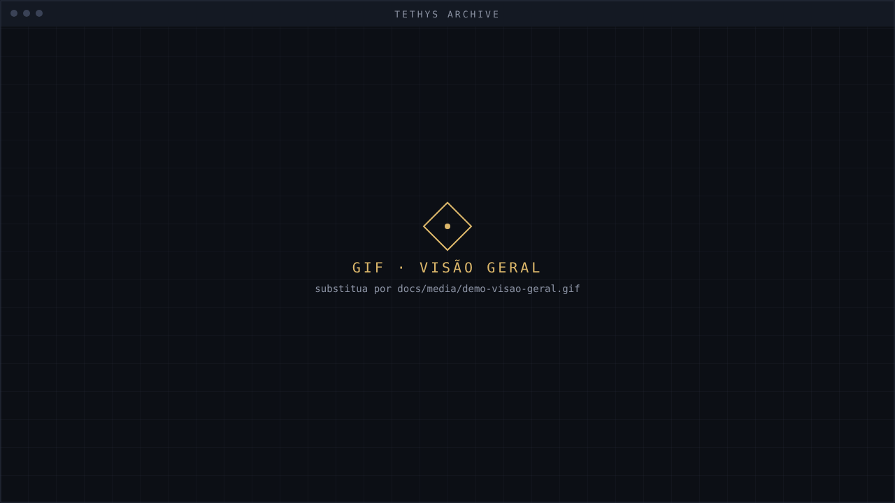
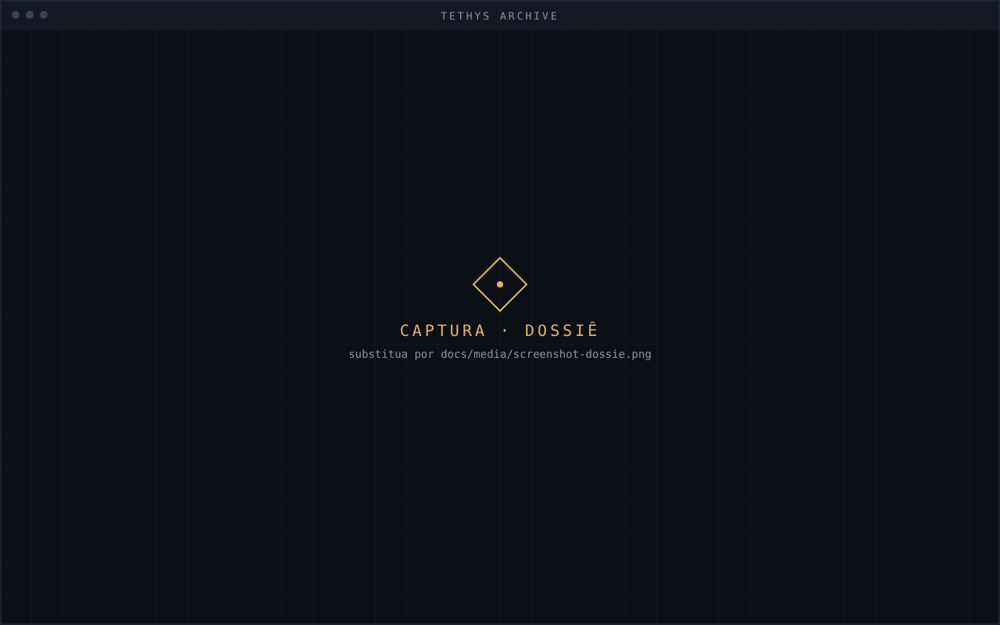
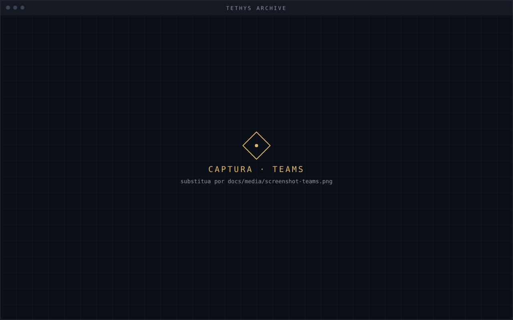
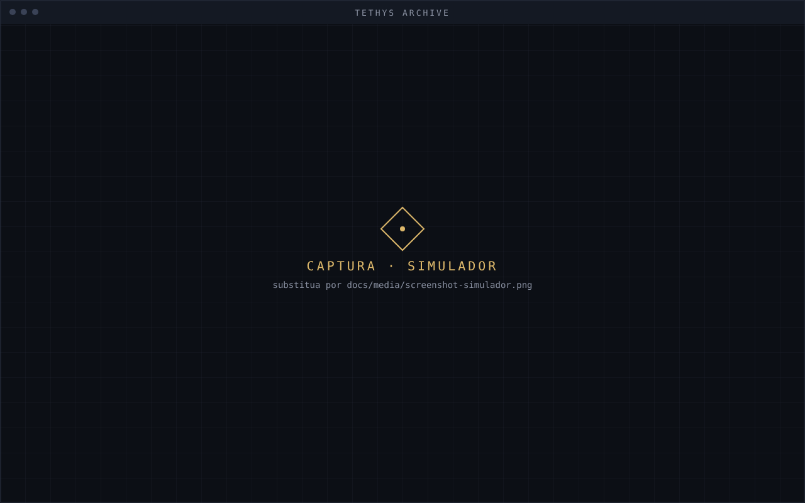
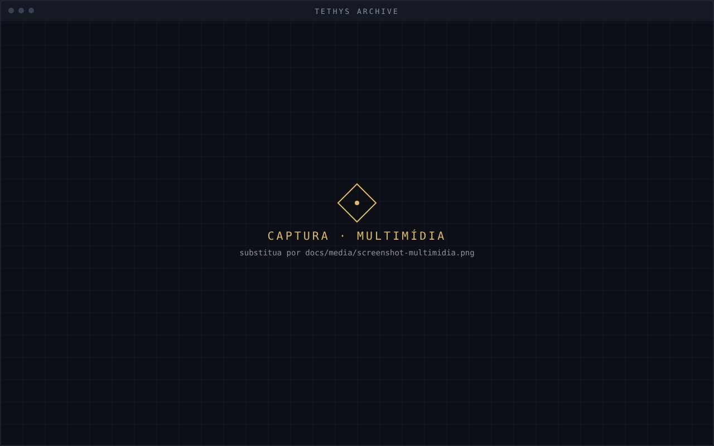
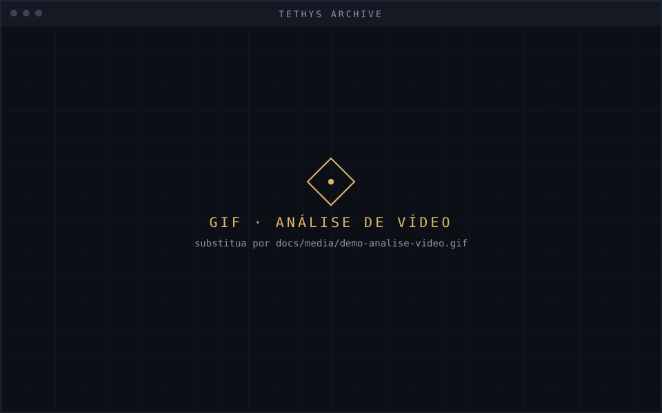
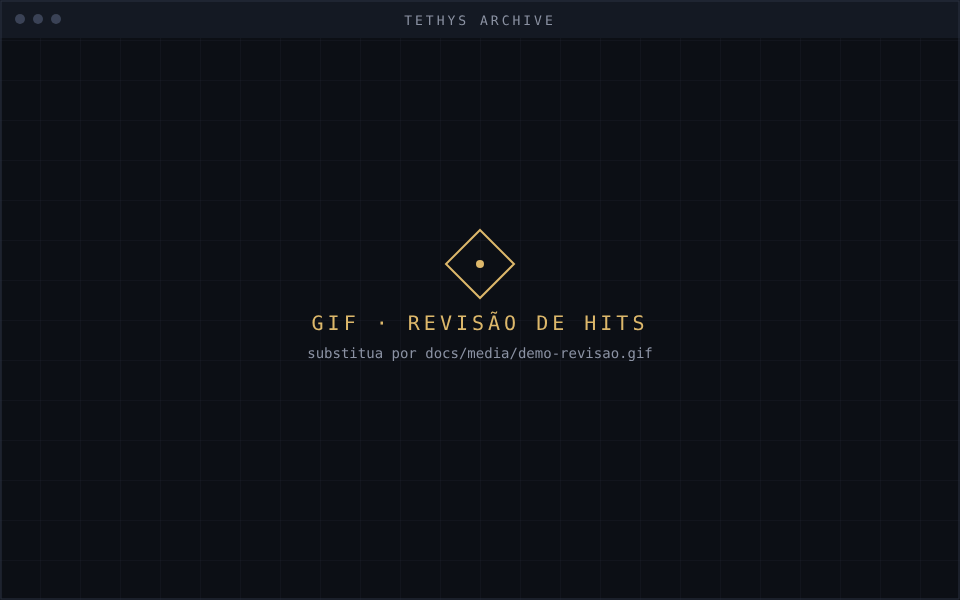

<div align="center">

<picture>
  <source media="(prefers-color-scheme: dark)" srcset="docs/media/banner-dark.svg">
  
</picture>

**Look up Resonators, build teams, simulate rotations and measure the damage in combat recordings.**


[Overview](#overview) · [Modules](#modules) · [Video analysis](#video-analysis) · [Installation](#installation) · [Data and privacy](#data-and-privacy) · [Configuration](#configuration) · [Roadmap](#roadmap) · [License](#license)

[Português](README.md) · **English**

</div>


<p align="center">
  
</p>

## Overview

**Tethys Archive** is a desktop app (Windows and Linux) to look up Resonators, build teams, simulate rotations and analyze the damage shown in *Wuthering Waves* combat recordings. It compares what the simulation predicts with what happened in the video.

In the project's setting, the app is an internal terminal of the **Black Shores**:

```text
[ TETHYS ARCHIVE / RESONATOR ARCHIVE ]
Unit       GARDENERS · BLACK SHORES
Session    AWAITING RESONATOR ID
```

> *I gathered in this terminal the files of the Resonators we follow and the records of how they fight. If you are evaluating a candidate, use the results to recommend a role. If the dossier is about an adversary, study the rotation and note what your team needs to know before the next encounter.*
>
> — Note from a Gardener of the Black Shores

### Combat assessment

| | |
| --- | --- |
| **01 · Open the dossier** | Look up the Resonator by ID and review stats, weapons and skills. |
| **02 · Set the scenario** | In **Teams**, configure Echoes and simulate the Resonator as main DPS or support. Check elemental synergies and Sonata effects. |
| **03 · Compare simulation and field** | Calculate the expected damage of the rotation and use **Multimedia** to analyze a combat recording. |
| **04 · Record the results** | Save rotations and comparisons in **History**, to recommend a role to a candidate or understand how an ally or adversary fights. |


## Gallery

<table>
  <tr>
    <td width="50%"><br><sub><b>Dossier</b> · stats, weapons and skills</sub></td>
    <td width="50%"><br><sub><b>Teams</b> · Echoes, synergies and Sonatas</sub></td>
  </tr>
  <tr>
    <td width="50%"><br><sub><b>Simulator</b> · rotation and scenario damage</sub></td>
    <td width="50%"><br><sub><b>Multimedia</b> · video damage and DPS</sub></td>
  </tr>
</table>

## Modules

<table>
  <tr>
    <td width="72"></td>
    <td><b>Resonator Dossier</b><br>Look up by ID: stats, weapons, skills and images. Text follows the language set in the app (pt-BR or English).</td>
  </tr>
  <tr>
    <td></td>
    <td><b>Rotation Simulator</b><br>Calculates skill and rotation damage to compare scenarios.</td>
  </tr>
  <tr>
    <td></td>
    <td><b>Teams</b><br>Builds and saves teams, sets the main DPS and supports, configures Echoes and shows elemental synergies and the Sonata summary.</td>
  </tr>
  <tr>
    <td></td>
    <td><b>History</b><br>Stores rotations and damage comparisons. Imports and exports records as JSON.</td>
  </tr>
  <tr>
    <td></td>
    <td><b>Multimedia</b><br>Plays local reference videos and analyzes the damage shown during combat.</td>
  </tr>
</table>


## Video analysis

The simulation computes damage from the rotation parameters. Video analysis works the other way around: it reads the damage numbers shown in the recording with a **native C++ engine** (OpenCV and ONNX Runtime) called from Python. Results depend on how legible those numbers are.

<picture>
  <source media="(prefers-color-scheme: dark)" srcset="docs/media/pipeline-dark.svg">
  
</picture>

(The diagram labels are in Portuguese: VÍDEO = video, MÁSCARA = mask, LEITURA = reading, RASTREIO = tracking, REVISÃO = review.)

### How to use

1. Open **Multimedia** and pick a local combat recording.
2. Fill in **Skip intro** (start time to discard) and **Analysis start** (where reading begins), both as `mm:ss`. The terminal uses the later of the two: with an intro of `00:05` and a start of `00:12`, reading begins at `00:12`.
3. Choose the analysis mode and start.
4. Check the chart: damage over time, DPS, cumulative damage, the formula, and the highest and lowest values detected.

### Two modes

| Mode | How it works |
| --- | --- |
| **Engine only** | Automatic. Sums the confirmed hits. Identical numbers stacked in the same spot count as copies. Anything the engine cannot confirm stays **out of the total** and is reported in the result. |
| **With my review** | For each doubtful hit, a window shows the video crop. You **accept** the reading, **correct** it (`785 + 2518` or `2071 x3`) or **discard** what is not damage. Shortcuts: `A` accept, `D` discard, arrows to navigate. |

<table>
  <tr>
    <td width="50%"><br><sub>Video analysis and damage chart</sub></td>
    <td width="50%"><br><sub>Reviewing a doubtful hit</sub></td>
  </tr>
</table>


## Installation

| Platform | Availability |
| --- | --- |
| Windows 10 or later | From source |
| Linux | From source. **AppImage** planned for the first distribution |

The video engine is a compiled module (`damage_analyzer`). **Without it the app opens normally**, but video analysis shows "Native engine failure".

### 1. Python environment

Requires **Python 3.11 or later**.

**Linux**

```bash
python3 -m venv .venv
.venv/bin/python -m pip install --upgrade pip
.venv/bin/python -m pip install -e .
.venv/bin/python tethys.py
```

**Windows (PowerShell)**

```powershell
python -m venv .venv
.\.venv\Scripts\python.exe -m pip install --upgrade pip
.\.venv\Scripts\python.exe -m pip install -e .
.\.venv\Scripts\python.exe tethys.py
```

### 2. Video engine (optional, for analysis)

Tools: **CMake 3.20+**, a **C++20** compiler, **OpenCV** (`core`, `videoio`, `imgproc`), **pybind11** and **ONNX Runtime** in `src/wuwa_calculator/native/damage_analyzer/third_party/onnxruntime`.

```bash
cmake -S src/wuwa_calculator/native/damage_analyzer -B build -DCMAKE_BUILD_TYPE=Release
cmake --build build -j
```

> **Note:** the generated module carries the Python version tag (for example `cpython-312`). Build with the **same Python as the `.venv`** and check with `python -c "import damage_analyzer"`.

### Linux · planned AppImage

The **AppImage** will bundle the Python runtime and dependencies, so the terminal starts without setting up a virtual environment. Ubuntu 22.04+, Debian 12+ and Fedora are the initial validation targets (UI on X11 and Wayland, audio and video, damage reading and graphics acceleration). Validated requirements will be documented with the package.

## Data and privacy

Teams, history and preferences stay **only on your machine**, in the user data directory:

| System | Default path |
| --- | --- |
| Linux | `~/.local/share/tethys` |
| Windows | `%LOCALAPPDATA%\Tethys` |

Set `TETHYS_HOME` to change the location. Use the JSON export in the **History** tab to keep or move records.

**Training example collection (optional, off by default).** In *With my review* mode you can allow the app to keep the number crops and your corrections in `<data directory>/training`. They are used to train a better digit reader. **Nothing is sent over the internet**; to delete, remove the `training` folder. To export the set: `python tools/export_training_dataset.py`.

The Home banner, images and analysis resources may query external sources when used. Without a network the app keeps working offline.

## Configuration

| Variable | Purpose |
| --- | --- |
| `TETHYS_HOME` | User data directory. |
| `TETHYS_BANNER_API_URL` | External source for the current Home banner. Unavailable → offline mode. |

**Wallpaper.** The default file is `Assets/app_background_reference.png`, located from the project root. For custom images, prefer a **16:10** ratio, up to **1440 × 900 px**.

## Roadmap

- **Dossier expansion:** affiliation history (faction, role and period), relation to the Black Shores (ally, candidate, adversary or unknown) and lore records with source and chapter. Story reveals stay collapsed by default.
- **Own digit reader:** a small neural network trained on synthetic examples and on review corrections, to separate overlapping numbers.
- **Element colors:** tuning detection for green, cyan, purple and pink numbers.
- **AppImage** for Linux.

<details>
<summary><b>Lore references</b></summary>

<br>

In the game, Paranora describes how the **Gardeners** gather information on candidates and how the Tethys sets a tailored **Germination Test** for each one. Tykwer identifies Camellya as the evaluator of the combat tests. The Resonator Archive and the Gardener's note are project creations inspired by that process.

- [Paranora — dialogue about recruitment and test preparation](https://wutheringwaves.fandom.com/wiki/Paranora)
- [Tykwer — dialogue about the combat tests](https://wutheringwaves.fandom.com/wiki/Tykwer)
- [Camellya — developer's notes on recruit selection](https://wutheringwaves.notion.site/Developer-s-Notes-Camellya-14bef7f91e4b81fbab4bc266df913727)

</details>


## License

Tethys Archive code is released under the MIT license. See [`LICENSE`](LICENSE).

<sub>*Tethys Archive is a non-profit fan project inspired by Wuthering Waves by Kuro Games. It is not affiliated with or endorsed by Kuro Games. Names and trademarks belong to their owners.*</sub>


Development and imports: install with `python -m pip install -e ".[dev]"` and run `python -m pytest`. Import `wuwa_calculator...`; `src` is only the source directory. Explicit relative imports within a subpackage are valid. After installation, `tethys` starts the app. The `python tethys.py` launcher still supports running a checkout directly.


Screenshot OCR is optional: `python -m pip install -e ".[ocr]"`. PaddlePaddle has no wheel for this environment’s Python 3.14; use a separate environment with a supported Python version (for example, 3.12) for this feature. Base installation and tests do not require PaddlePaddle. The native video engine has its own OCR configuration.
