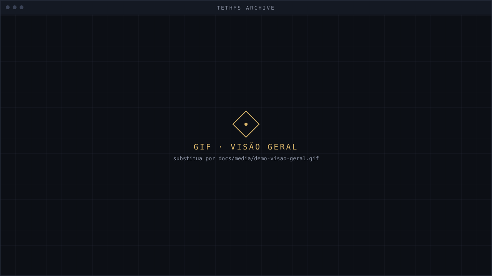
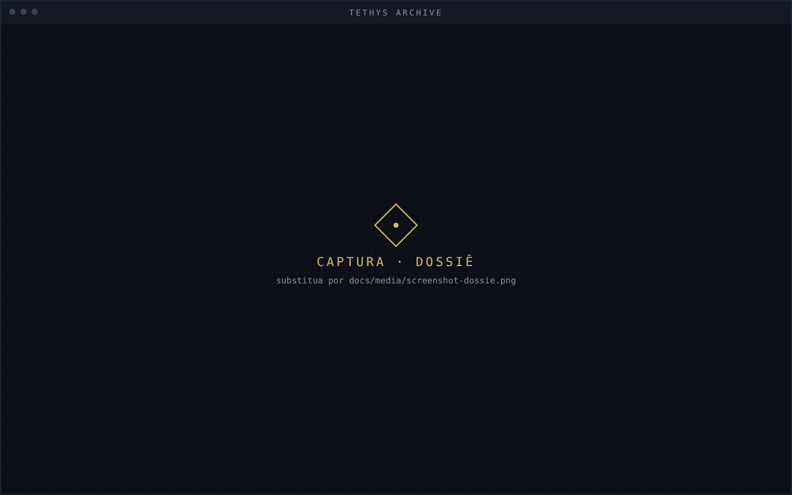
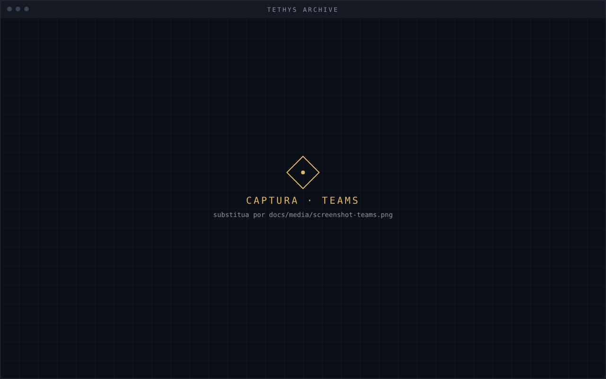
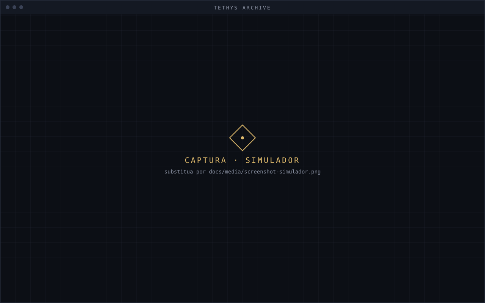
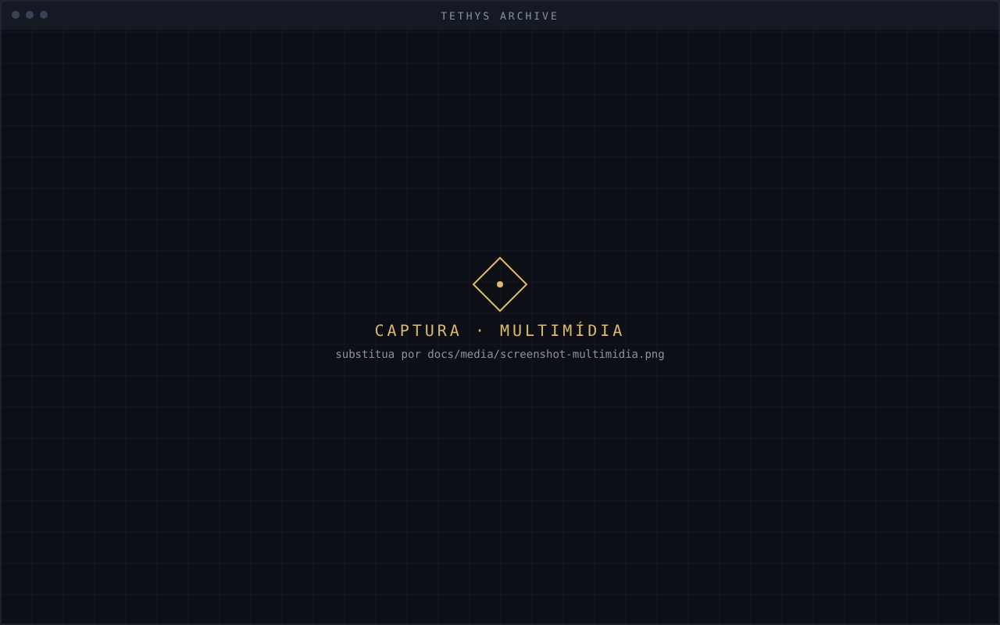
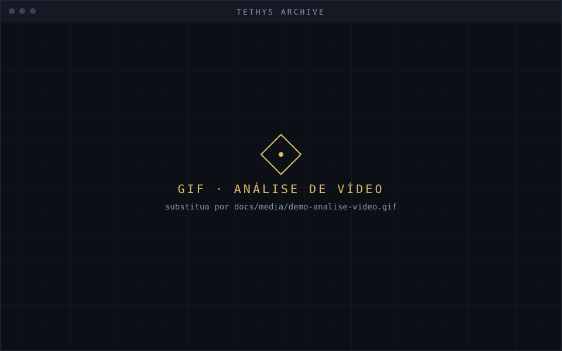
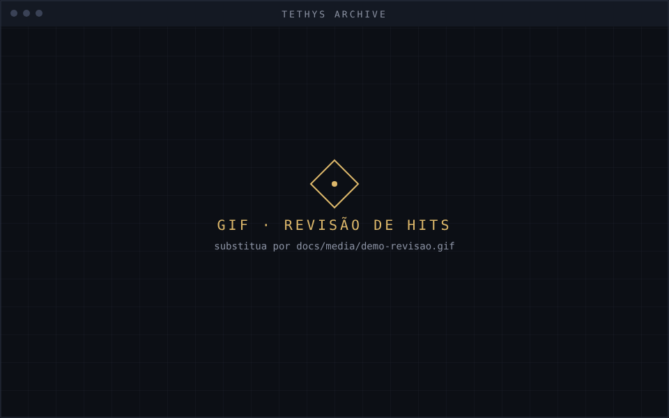

<div align="center">

<!-- IMAGEM 1 · banner animado (pronto). Fonte: docs/media/banner-*.svg -->
<picture>
  <source media="(prefers-color-scheme: dark)" srcset="docs/media/banner-dark.svg">
  
</picture>

**Consulte Ressonadores, monte equipes, simule rotações e meça o dano de gravações de combate.**


[Visão geral](#visão-geral) · [Módulos](#módulos) · [Análise de vídeo](#análise-de-vídeo) · [Instalação](#instalação) · [Dados e privacidade](#dados-e-privacidade) · [Configuração](#configuração) · [Roadmap](#roadmap) · [Licença](#licença)

**Português** · [English](README.en.md)

</div>


<!-- IMAGEM 2 · GIF principal (8–12 s): abrir um dossiê → montar equipe → analisar um vídeo.
     É o que o visitante vê primeiro. Troque o placeholder por docs/media/demo-visao-geral.gif -->
<p align="center">
  
</p>

## Visão geral

O **Tethys Archive** é um aplicativo de desktop (Windows e Linux) para consultar Ressonadores, montar equipes, simular rotações e analisar o dano exibido em gravações de combate de *Wuthering Waves*. Ele compara o que a simulação prevê com o que aconteceu no vídeo.

Na ambientação do projeto, o app é um terminal interno das **Black Shores**:

```text
[ TETHYS ARCHIVE / ARQUIVO DE RESSONADORES ]
Unidade    JARDINEIROS · BLACK SHORES
Sessão     AGUARDANDO ID DO RESSONADOR
```

> *Reuni neste terminal as fichas dos Ressonadores que acompanhamos e os registros de como lutam. Se estiver avaliando um candidato, use os resultados para recomendar uma função. Se o dossiê for de um adversário, estude a rotação e registre o que sua equipe precisa saber antes do próximo encontro.*
>
> — Nota de um Jardineiro das Black Shores

### Avaliação de combate

| | |
| --- | --- |
| **01 · Abra o dossiê** | Consulte o Ressonador por ID e revise atributos, armas e habilidades. |
| **02 · Defina o cenário** | Em **Teams**, configure os Echos e simule o Ressonador como DPS principal ou suporte. Confira sinergias elementais e efeitos de Sonata. |
| **03 · Compare simulação e campo** | Calcule o dano esperado da rotação e use **Multimídia** para analisar uma gravação de combate. |
| **04 · Registre os resultados** | Salve rotações e comparações no **Histórico**, para recomendar uma função a um candidato ou entender como um aliado ou adversário luta. |


## Galeria

<!-- IMAGENS 3–6 · capturas de tela, 1280×800, mesma resolução e mesma janela.
     Dica: use o mesmo Ressonador nas quatro, para a galeria parecer um conjunto. -->
<table>
  <tr>
    <td width="50%"><br><sub><b>Dossiê</b> · atributos, armas e habilidades</sub></td>
    <td width="50%"><br><sub><b>Teams</b> · Echos, sinergias e Sonatas</sub></td>
  </tr>
  <tr>
    <td width="50%"><br><sub><b>Simulador</b> · dano de rotações e cenários</sub></td>
    <td width="50%"><br><sub><b>Multimídia</b> · dano e DPS do vídeo</sub></td>
  </tr>
</table>

## Módulos

<!-- Ícones prontos (SVG próprio): docs/media/icon-*.svg -->
<table>
  <tr>
    <td width="72"></td>
    <td><b>Dossiê de Ressonadores</b><br>Consulta por ID: atributos, armas, habilidades e imagens. O texto segue o idioma configurado no app (pt-BR ou inglês).</td>
  </tr>
  <tr>
    <td></td>
    <td><b>Simulador de Rotações</b><br>Calcula o dano de habilidades e rotações para comparar cenários.</td>
  </tr>
  <tr>
    <td></td>
    <td><b>Teams</b><br>Monta e salva equipes, define Main DPS e suportes, configura Echos e mostra sinergias elementais e o resumo de Sonatas.</td>
  </tr>
  <tr>
    <td></td>
    <td><b>Histórico</b><br>Guarda rotações e comparações de dano. Importa e exporta registros em JSON.</td>
  </tr>
  <tr>
    <td></td>
    <td><b>Multimídia</b><br>Reproduz vídeos locais de referência e analisa o dano exibido durante o combate.</td>
  </tr>
</table>


## Análise de vídeo

A simulação calcula o dano a partir dos parâmetros da rotação. A análise de vídeo faz o caminho inverso: lê os números de dano que aparecem na gravação, com uma **engine nativa em C++** (OpenCV e ONNX Runtime) chamada pelo Python. A leitura depende da legibilidade desses números.

<picture>
  <source media="(prefers-color-scheme: dark)" srcset="docs/media/pipeline-dark.svg">
  
</picture>

### Como usar

1. Abra **Multimídia** e selecione uma gravação local de combate.
2. Preencha **Ignorar vinheta** (tempo inicial a descartar) e **Início da análise** (onde a leitura começa), ambos em `mm:ss`. O terminal usa o maior dos dois: com vinheta em `00:05` e início em `00:12`, a leitura começa em `00:12`.
3. Escolha o modo de análise e inicie.
4. Consulte o gráfico: dano ao longo do tempo, DPS, dano acumulado, fórmula e os maiores e menores valores detectados.

### Dois modos

| Modo | Como funciona |
| --- | --- |
| **Somente a engine** | Automático. Soma os hits confirmados. Números empilhados no mesmo lugar contam como cópias. O que a engine não confirma fica **fora do total** e é informado no resultado. |
| **Com revisão minha** | Para cada hit duvidoso, uma janela mostra o recorte do vídeo. Você **aceita** a leitura, **corrige** (`785 + 2518` ou `2071 x3`) ou **descarta** o que não é dano. Atalhos: `A` aceitar, `D` descartar, setas para navegar. |

<!-- IMAGENS 7–8 · GIFs da análise (8–10 s cada), 960×600.
     demo-analise-video: iniciar a análise e ver o gráfico se formar.
     demo-revisao: corrigir um hit com "785 + 2518". -->
<table>
  <tr>
    <td width="50%"><br><sub>Análise do vídeo e gráfico de dano</sub></td>
    <td width="50%"><br><sub>Revisão de um hit duvidoso</sub></td>
  </tr>
</table>


## Instalação

| Plataforma | Disponibilidade |
| --- | --- |
| Windows 10 ou superior | A partir do código-fonte |
| Linux | A partir do código-fonte. **AppImage** planejado para a primeira distribuição |

A engine de vídeo é um módulo compilado (`damage_analyzer`). **Sem ele o app abre normalmente**, mas a análise de vídeo mostra "Falha na engine nativa".

### 1. Ambiente Python

Requer **Python 3.11 ou superior**.

**Linux**

```bash
python3 -m venv .venv
.venv/bin/python -m pip install --upgrade pip
.venv/bin/python -m pip install -e .
.venv/bin/python tethys.py
```

**Windows (PowerShell)**

```powershell
python -m venv .venv
.\.venv\Scripts\python.exe -m pip install --upgrade pip
.\.venv\Scripts\python.exe -m pip install -e .
.\.venv\Scripts\python.exe tethys.py
```

### 2. Engine de vídeo (opcional, para a análise)

Ferramentas: **CMake 3.20+**, compilador **C++20**, **OpenCV** (`core`, `videoio`, `imgproc`), **pybind11** e **ONNX Runtime** em `src/wuwa_calculator/native/damage_analyzer/third_party/onnxruntime`.

```bash
cmake -S src/wuwa_calculator/native/damage_analyzer -B build -DCMAKE_BUILD_TYPE=Release
cmake --build build -j
```

> **Atenção:** o módulo gerado carrega o número da versão do Python (por exemplo `cpython-312`). Compile com o **mesmo Python do `.venv`** e confirme com `python -c "import damage_analyzer"`.

### Linux · AppImage planejado

O **AppImage** vai incluir o runtime Python e as dependências, para iniciar o terminal sem configurar um ambiente virtual. Ubuntu 22.04+, Debian 12+ e Fedora são os alvos iniciais de validação (interface em X11 e Wayland, áudio e vídeo, leitura de dano e aceleração gráfica). Os requisitos validados serão documentados junto ao pacote.

## Dados e privacidade

Equipes, histórico e preferências ficam **somente na sua máquina**, no diretório de dados do usuário:

| Sistema | Caminho padrão |
| --- | --- |
| Linux | `~/.local/share/tethys` |
| Windows | `%LOCALAPPDATA%\Tethys` |

Defina `TETHYS_HOME` para mudar o local. Use a exportação em JSON na aba **Histórico** para guardar ou transferir registros.

**Coleta de exemplos de treino (opcional, desligada por padrão).** No modo *Com revisão minha*, você pode permitir que o app guarde os recortes dos números e as suas correções, em `<diretório de dados>/training`. Esses exemplos servem para treinar um leitor de dígitos melhor. **Nada é enviado pela internet**; para apagar, remova a pasta `training`. Para exportar o conjunto: `python tools/export_training_dataset.py`.

O banner da Home, imagens e recursos de análise podem consultar fontes externas quando usados. Sem rede, o app continua funcionando em modo offline.

## Configuração

| Variável | Finalidade |
| --- | --- |
| `TETHYS_HOME` | Diretório de dados do usuário. |
| `TETHYS_BANNER_API_URL` | Fonte externa do banner atual na Home. Indisponível → modo offline. |

**Wallpaper.** O arquivo padrão é `Assets/app_background_reference.png`, localizado a partir da raiz do projeto. Para imagens próprias, prefira a proporção **16:10**, com até **1440 × 900 px**.

## Roadmap

- **Expansão do dossiê:** histórico de afiliações (facção, cargo e período), relação com as Black Shores (aliado, candidato, adversário ou desconhecido) e registros de lore com fonte e capítulo. Revelações da história ficam recolhidas por padrão.
- **Leitor de dígitos próprio:** rede neural pequena, treinada com exemplos sintéticos e com as correções feitas na revisão, para separar números sobrepostos.
- **Cores dos elementos:** ajuste da detecção para números verdes, ciano, roxos e rosas.
- **AppImage** para Linux.

<details>
<summary><b>Referências de lore</b></summary>

<br>

No jogo, Paranora descreve como os **Gardeners** reúnem informações sobre candidatos e como o Tethys define um **Germination Test** sob medida para cada um. Tykwer identifica Camellya como avaliadora dos testes de combate. O Arquivo de Ressonadores e a nota do Jardineiro são criações do projeto inspiradas nesse processo. Aqui, **Jardineiros** e **Teste de Germinação** traduzem os termos em inglês.

- [Paranora — diálogo sobre recrutamento e preparação dos testes](https://wutheringwaves.fandom.com/wiki/Paranora)
- [Tykwer — diálogo sobre os testes de combate](https://wutheringwaves.fandom.com/wiki/Tykwer)
- [Camellya — notas de desenvolvimento sobre a seleção de recrutas](https://wutheringwaves.notion.site/Developer-s-Notes-Camellya-14bef7f91e4b81fbab4bc266df913727)

</details>


## Licença

O código do Tethys Archive é distribuído sob a licença MIT. Consulte [`LICENSE`](LICENSE).

<sub>*Tethys Archive é um projeto de fãs, sem fins lucrativos, inspirado em Wuthering Waves, da Kuro Games. Não é afiliado nem endossado pela Kuro Games. Nomes e marcas pertencem aos seus donos.*</sub>


Desenvolvimento e imports: instale com `python -m pip install -e ".[dev]"` e execute `python -m pytest`. Use `wuwa_calculator...` nos imports; `src` é apenas o diretório de fontes. Imports relativos explícitos dentro de um subpacote são válidos. Após a instalação, o comando `tethys` inicia o aplicativo. O launcher `python tethys.py` continua compatível com a execução direta do checkout.


O OCR de screenshots é opcional: `python -m pip install -e ".[ocr]"`. O PaddlePaddle não oferece wheel para o Python 3.14 deste ambiente; para esse recurso, use um ambiente separado com Python compatível (por exemplo, 3.12). A instalação básica e os testes não exigem PaddlePaddle. A engine nativa de vídeo tem sua própria configuração de OCR.
